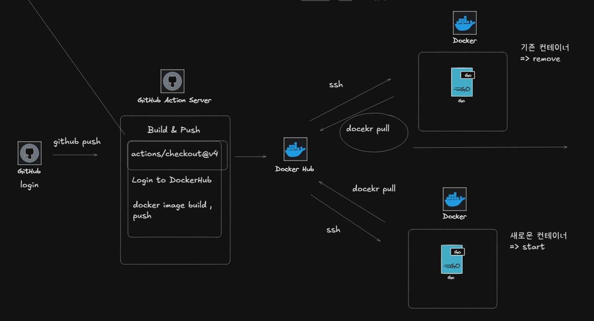

Docker Installation on Linux

https://github.com/WCSCourses/index/blob/main/Docker_guide.md

=> to avoid using **sudo** for docker commands

# add the user to the docker group 
1. sudo usermod -aG docker $USER
# changed group permissions will take effect immediately
2. newgrp docker

------------------------------------------------------------------

Github,Github Action -> Docker hub -> Server restart
(Delete the existing container and create a new one)

1. read or include the compose.yml file on the server

2. see the image:jeonhwan144/src:latest in the composey.yml file

3. send a network request directly the docker hub server to downloads the latest image(pull)

4. Delete the existing container and create a new container

